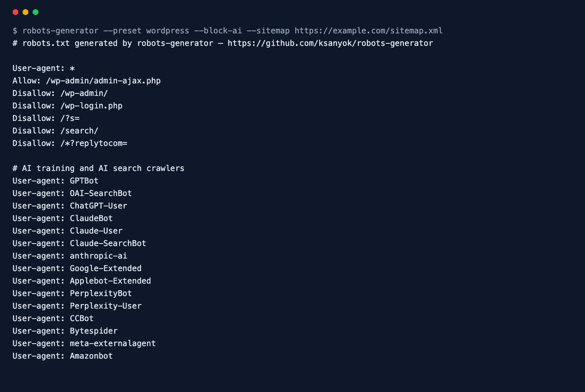

<div align="center">

# Robots.txt Generator

**Generate a correct robots.txt for your platform — and block AI crawlers in one flag.**

[](https://github.com/ksanyok/robots-generator/actions/workflows/ci.yml) [](LICENSE)   [](https://promopilot.link/en/tools/robots-generator.php?utm_source=github&utm_medium=repo&utm_campaign=tools&utm_content=robots-generator)

**[▶ Use the free online version — no install, no sign-up](https://promopilot.link/en/tools/robots-generator.php?utm_source=github&utm_medium=repo&utm_campaign=tools&utm_content=robots-generator)**

</div>

`robots-generator` writes a clean, valid `robots.txt` from a platform preset (WordPress, WooCommerce, Shopify, Magento, Next.js, Laravel or a locked-down staging site), your own `Allow`/`Disallow` rules and sitemap URLs. One flag adds a separate group that blocks 20 AI training and AI search crawlers — GPTBot, ClaudeBot, Google-Extended, Applebot-Extended, PerplexityBot, CCBot, Bytespider and more — and another blocks third-party SEO crawlers. Every result is linted for the mistakes that hurt SEO, and it fits straight into a build step.



## What it checks

- Platform presets with sensible rules: WordPress, WooCommerce, Shopify, Magento, Next.js, Laravel, and `staging` (block everything)
- Your own `Allow` / `Disallow` rules for all crawlers, normalised to start with `/`, duplicates removed
- Sitemap, Crawl-delay (Bing, Yandex) and Host (Yandex) lines
- `--block-ai`: one group disallowing 20 AI crawlers — GPTBot, OAI-SearchBot, ChatGPT-User, ClaudeBot, Claude-User, Claude-SearchBot, anthropic-ai, Google-Extended, Applebot-Extended, PerplexityBot, Perplexity-User, CCBot, Bytespider, meta-externalagent, Amazonbot, cohere-ai, Diffbot, YouBot, Timpibot, omgili
- `--block-seo`: AhrefsBot, SemrushBot, MJ12bot, DotBot, BLEXBot, DataForSeoBot, serpstatbot
- Lint before you ship: `Disallow: /` for everyone, blocked CSS/JS folders, full URLs used as paths, whitespace, relative sitemap URLs

## Why it matters

robots.txt is tiny but has outsized impact: one wrong line can stop search engines from crawling your site, and a missing one lets AI companies train on your content. Hand-written files drift between environments — the staging `Disallow: /` ends up in production, or a new section of the site is never excluded. Generating the file from a preset and a short config in your build makes it reproducible, reviewable in pull requests and different per environment on purpose.

## Quick start

```bash
# run straight from GitHub, nothing to install
npx github:ksanyok/robots-generator --preset wordpress --block-ai

# or install the CLI globally
npm install -g github:ksanyok/robots-generator
robots-generator --preset wordpress --block-ai
```

A Shopify-style store that also blocks SEO bots:

```bash
robots-generator -p shopify --block-seo -s https://shop.example.com/sitemap.xml -o robots.txt
```

Staging: block everything:

```bash
robots-generator -p staging -o public/robots.txt
```

From a JSON config kept in your repo:

```bash
robots-generator --config robots.config.json -o public/robots.txt
```

## Example output

```text
$ robots-generator --preset wordpress --block-ai --sitemap https://example.com/sitemap.xml
# robots.txt generated by robots-generator — https://github.com/ksanyok/robots-generator

User-agent: *
Allow: /wp-admin/admin-ajax.php
Disallow: /wp-admin/
Disallow: /wp-login.php
Disallow: /?s=
Disallow: /search/
Disallow: /*?replytocom=

# AI training and AI search crawlers
User-agent: GPTBot
User-agent: OAI-SearchBot
User-agent: ChatGPT-User
User-agent: ClaudeBot
User-agent: Claude-User
User-agent: Claude-SearchBot
User-agent: anthropic-ai
User-agent: Google-Extended
User-agent: Applebot-Extended
User-agent: PerplexityBot
User-agent: Perplexity-User
User-agent: CCBot
User-agent: Bytespider
User-agent: meta-externalagent
User-agent: Amazonbot
User-agent: cohere-ai
User-agent: Diffbot
User-agent: YouBot
User-agent: Timpibot
User-agent: omgili
Disallow: /

Sitemap: https://example.com/sitemap.xml
```

## CLI

```text
Usage: robots-generator [options]

Generates a robots.txt from a platform preset and your own rules, optionally
blocking AI and SEO crawlers, and checks it for common mistakes.

Options:
  -p, --preset <name>    default, wordpress, woocommerce, shopify, magento, nextjs, laravel, staging (default: default)
  -d, --disallow <path>  Add a Disallow rule for all crawlers (repeatable)
  -a, --allow <path>     Add an Allow rule for all crawlers (repeatable)
  -s, --sitemap <url>    Add a Sitemap line (repeatable)
  --block-ai             Block 20 AI crawlers (GPTBot, ClaudeBot, Google-Extended, CCBot…)
  --block-seo            Block third-party SEO crawlers (AhrefsBot, SemrushBot…)
  --crawl-delay <s>      Crawl-delay for all crawlers (Bing, Yandex)
  --config <file>        Read options from a JSON file
  -o, --out <file>       Write to a file instead of standard output
  --no-header            Omit the generator comment
  --json                 Print config, text and issues as JSON
  -h, --help             Show this help

Online version (no install): https://promopilot.link/en/tools/robots-generator.php
```

## Use as a library

```js
import { generateRobots, AI_CRAWLERS } from '@promopilot/robots-generator';

const { text, issues } = generateRobots({
  preset: 'nextjs',
  disallow: ['/drafts/'],
  sitemaps: ['https://example.com/sitemap.xml'],
  blockAi: process.env.BLOCK_AI === '1',
});
fs.writeFileSync('public/robots.txt', text);
```

`generateRobots(options)` returns `{ text, config, issues[] }`. Options: `preset`, `disallow[]`, `allow[]`, `sitemaps[]`, `blockAi`, `blockSeo`, `crawlDelay`, `host`, `extraGroups[]` (`{ agents, disallow, allow }`) and `header`. `buildConfig`, `renderRobots` and `lintConfig` are exported separately, as are the `PRESETS`, `AI_CRAWLERS` and `SEO_CRAWLERS` lists.

## Use in CI (GitHub Actions)

Generate robots.txt as part of the build, different per environment:

```yaml
on: [push]
jobs:
  build:
    runs-on: ubuntu-latest
    steps:
      - uses: actions/checkout@v4
      - uses: ksanyok/robots-generator@v1
        with:
          args: --preset nextjs --block-ai --sitemap https://example.com/sitemap.xml --out public/robots.txt
```

## How it works

Presets are plain data objects; your options are merged into the `User-agent: *` group, paths are normalised and deduplicated, and optional AI/SEO crawler groups are appended as separate groups (a crawler with its own group ignores the `*` group, which is exactly why blocking works without affecting Googlebot). Rendering follows RFC 9309 formatting: `User-agent` lines first, `Allow` before `Disallow`, an empty `Disallow:` for a group without rules, sitemaps at the end. Note that `Google-Extended` and `Applebot-Extended` control use of content for AI models without affecting normal search crawling.

## CLI vs. online version

| | This package | [Online tool](https://promopilot.link/en/tools/robots-generator.php?utm_source=github&utm_medium=repo&utm_campaign=tools&utm_content=robots-generator) |
|---|---|---|
| Runs on | Your machine, build, CI | Any browser |
| Config | Presets, flags, JSON file, code | Visual form |
| AI crawler list | Built in, one flag | Built in, checkboxes |
| Output | File, stdout, JSON | Copy or download |
| Price | Free, MIT | Free, no sign-up |


## FAQ

<details>
<summary><b>Does blocking AI crawlers hurt my Google rankings?</b></summary>

No. Google-Extended only controls whether Google may use your content for Gemini and AI training; Googlebot, which crawls for search, is not blocked. The same applies to Applebot-Extended.
</details>

<details>
<summary><b>Do AI crawlers respect robots.txt?</b></summary>

The major ones (OpenAI, Anthropic, Google, Apple, Perplexity, Common Crawl) document that they do. robots.txt is a convention, not access control — use authentication for content that must stay private.
</details>

<details>
<summary><b>Should I block /wp-admin/?</b></summary>

Yes, but keep `/wp-admin/admin-ajax.php` allowed, because themes and plugins use it for front-end features. The WordPress preset does this.
</details>

<details>
<summary><b>Can I keep a page out of Google with robots.txt?</b></summary>

No — Disallow stops crawling, not indexing. Use a `noindex` meta tag or header and allow crawling so Google can see it.
</details>

<details>
<summary><b>Where does the file go?</b></summary>

At the root of the host: `https://example.com/robots.txt`. Each subdomain needs its own file.
</details>

<details>
<summary><b>Is there a version without installing anything?</b></summary>

Yes — the [online Robots.txt Generator](https://promopilot.link/en/tools/robots-generator.php?utm_source=github&utm_medium=repo&utm_campaign=tools&utm_content=robots-generator) runs the same checks in the browser and explains each result.
</details>

## Related free tools

- [Robots.txt Checker](https://promopilot.link/en/tools/robots-checker.php?utm_source=github&utm_medium=repo&utm_campaign=tools&utm_content=robots-checker) — test robots.txt rules against any URL
- [Sitemap Generator](https://promopilot.link/en/tools/sitemap-generator.php?utm_source=github&utm_medium=repo&utm_campaign=tools&utm_content=sitemap-generator) — crawl a site and build sitemap.xml
- [Sitemap Analyzer](https://promopilot.link/en/tools/sitemap-analyzer.php?utm_source=github&utm_medium=repo&utm_campaign=tools&utm_content=sitemap-analyzer) — validate XML sitemaps and sitemap indexes
- [Meta Tag Analyzer](https://promopilot.link/en/tools/meta-analyzer.php?utm_source=github&utm_medium=repo&utm_campaign=tools&utm_content=meta-analyzer) — title, description, canonical, robots and Open Graph
- [Redirect Checker](https://promopilot.link/en/tools/redirect-checker.php?utm_source=github&utm_medium=repo&utm_campaign=tools&utm_content=redirect-checker) — trace redirect chains, loops and status codes
- [All 120+ free SEO, email and web tools](https://promopilot.link/en/tools/?utm_source=github&utm_medium=repo&utm_campaign=tools&utm_content=robots-generator)

## Contributing

Bug reports and pull requests are welcome — see [CONTRIBUTING.md](CONTRIBUTING.md). Security issues: [SECURITY.md](SECURITY.md).
More docs live in the [wiki](https://github.com/ksanyok/robots-generator/wiki) (sources in [docs/wiki](docs/wiki)).

## License

[MIT](LICENSE) © 2026 Alexandr Krikun

---

<sub>Built and maintained by the team behind [PromoPilot](https://promopilot.link/?utm_source=github&utm_medium=repo&utm_campaign=tools&utm_content=robots-generator) — link building, SEO monitoring and 120+ free tools for site owners. Also on [YouTube](https://www.youtube.com/channel/UCPB8m7BgaexcZh0Vr49ViYA).</sub>
